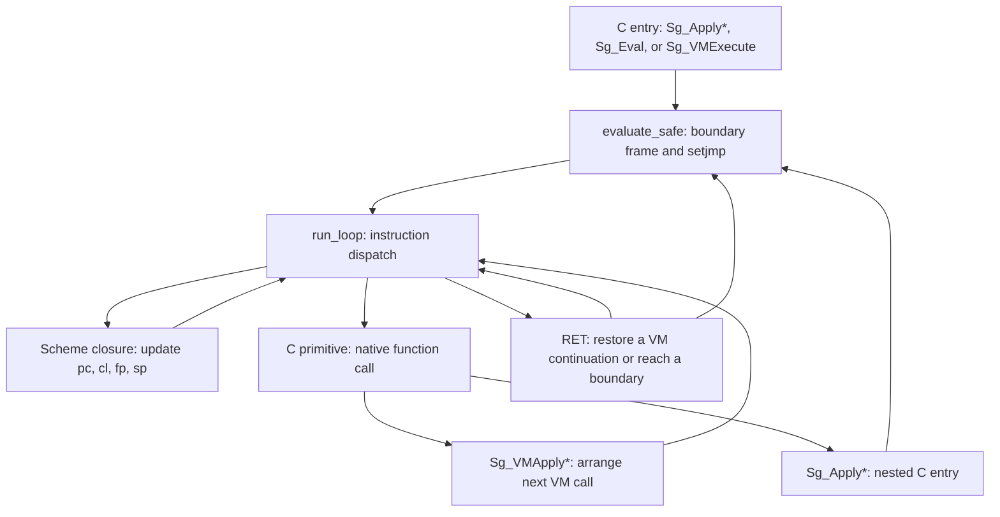

[§1] Sagittarius VM architecture
================================

This guide describes the implementation centred on
[`src/vm.c`](../../src/vm.c). It follows actual frame representations and
control transfers, rather than treating a Scheme continuation as a native
return address.

The pages are linked Markdown, separate from the public reference manual.
Read them in a Mermaid-capable Markdown viewer to render the diagrams.

[§2] Reading map
----------------

| Page | Contents |
| ---- | -------- |
| [Stack and frames](vm/stack.md) | Registers, argument layout, frame formats, calls, returns, tail calls, and stack spilling. |
| [Continuations](vm/continuations.md) | Capture, heap preservation, invocation, dynamic state, prompts, and barriers. |
| [C and Scheme interaction](vm/c-interface.md) | Native stack boundaries, synchronous calls, VM-scheduled calls, C continuations, and non-local exits. |
| [Instruction reference](vm/instructions.md) | All active opcodes, operand encoding, stack/accumulator effects, branches, calls, multiple values, and fusion details. |
| [Execution and runtime state](vm/execution.md) | Startup, bootstrap compiler, wordcode, procedure dispatch, values, GC, attention requests, and optional native-execution hooks. |

[§2] The execution model
------------------------

Sagittarius is an accumulator-based VM with an explicit Scheme stack. A
Scheme-to-Scheme call normally changes VM registers and continues the
interpreter loop; it does not recursively call that loop in C.

A C primitive is called as a native function. It can either schedule more
Scheme work in the existing loop or enter a nested interpreter invocation.
These are different operations, exposed by the `Sg_VMApply*` and `Sg_Apply*`
families respectively.

The return arrows are alternatives: an ordinary return continues dispatch;
reaching a C boundary returns control to its `evaluate_safe` invocation.
The [C interaction page](vm/c-interface.md) explains why nesting C entries
is not equivalent to adding ordinary VM frames.

[§2] Three different meanings of continuation
--------------------------------------------

| Representation | Meaning | Lifetime |
| -------------- | ------- | -------- |
| `SgContFrame` | One pending VM return action: saved Scheme execution state, a prompt/boundary marker, or a C callback. | Initially often in the VM stack; preserved in GC-managed heap memory when necessary. |
| `SgContinuation` | Captured continuation state used by continuation procedures; also used for error escape points. | GC-managed data referring to frames and dynamic state. |
| `SgCStack` | A live native recovery boundary containing a `jmp_buf` and its associated VM frame. | A C automatic variable in `evaluate_safe` or an unwind-protection scope. |

Definitions:
[`SgContFrame`, `SgCStack`, and `SgContinuation`](../../src/sagittarius/private/vm.h#L76).

**Capturing a continuation does not copy the native C stack.** It preserves
VM frames, records dynamic state, and, for a full continuation, remembers
which C boundary was current. Invocation checks that boundary against the
live C boundary chain before attempting a non-local jump.

[§2] State and lifetime invariants
----------------------------------

- The normal VM stack is a fixed-size, heap-allocated array of `SgObject`
  slots, separate from the native stack. Saved frames can be moved out of
  that array; the current frame can be compacted to its base.
- `cont` is a linked chain, not necessarily a contiguous stack walk.
  Stack-resident frames can lead to older heap-resident frames.
- A saved frame's program counter is not always executable wordcode.
  Frame type and the C-continuation marker determine how to interpret it.
- Restoring stack slots does not undo mutation of objects referenced by
  those slots.
- A continuation transition includes winders, marks, and prompt bookkeeping,
  not just `pc`, `fp`, and `sp`.
- VM frame preservation does not extend the lifetime of a C local variable,
  a `jmp_buf`, or a native caller.

The details and implementation limits are described in the linked pages.

[§2] Source map
---------------

| Source | Responsibility |
| ------ | -------------- |
| [`src/vm.c`](../../src/vm.c) | VM lifecycle, entry/recovery loop, frame operations, continuations, dynamic state, and interpreter dispatch. |
| [`src/sagittarius/private/vm.h`](../../src/sagittarius/private/vm.h) | Register set, frame layouts, C boundaries, continuation metadata, and C entry declarations. |
| [`src/instructions.scm`](../../src/instructions.scm), generated [`src/vminsn.c`](../../src/vminsn.c) | Instruction definitions and generated C bodies included by the interpreter; catalogued in the [instruction reference](vm/instructions.md). |
| [`src/vmcall.c`](../../src/vmcall.c) | General procedure dispatch and argument normalization, included by the call instructions. |
| [`src/main.c`](../../src/main.c#L536), [`src/core.c`](../../src/core.c#L155) | Executable entry, runtime initialization, and startup into Scheme. |
| [`boot/lib/program.scm`](../../boot/lib/program.scm#L31) | Scheme-level script, standard-mode, and REPL startup. |
| [`boot/compiler.scm`](../../boot/compiler.scm#L41), [`boot/lib/pass5.scm`](../../boot/lib/pass5.scm#L822) | Runtime compilation and emission of calls, return frames, and tail calls. |

These are internal implementation interfaces, not a stable embedding ABI.
