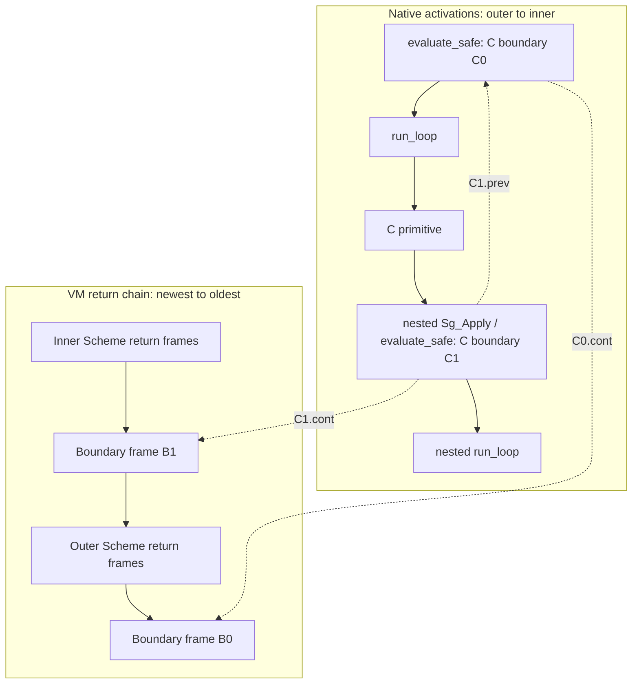
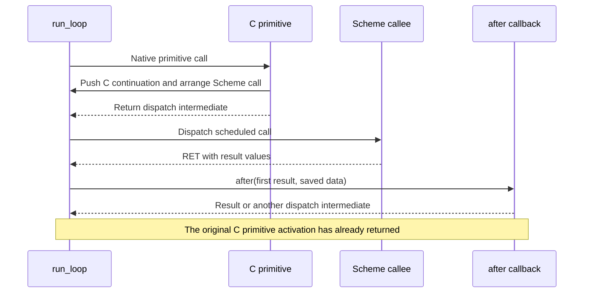

[§1] C and Scheme interaction
=============================

[VM architecture](../vm.md) |
[Stack and frames](stack.md) |
[Continuations](continuations.md) |
[Execution](execution.md) |
[Instructions](instructions.md)

[§2] Two stacks, with explicit boundaries
-----------------------------------------

The native stack holds interpreter activations, C primitive/helper
activations, C local variables, and `setjmp` recovery records. The VM stack
holds Scheme arguments, local slots, and VM continuation records. Heap
preservation applies to the latter records, not the former activations.

An ordinary C primitive call does not automatically install a new
`SgCStack`. A new synchronous VM entry through `evaluate_safe` does.
Unwind-protection scopes can also add C recovery records.

The frame records in the lower chain can move to the heap. The `C0` and
`C1` recovery records remain native automatic variables and are valid only
while their C scopes are active.

Sources:
[`SgCStack`](../../../src/sagittarius/private/vm.h#L100),
[`evaluate_safe`](../../../src/vm.c#L3890),
[`C primitive dispatch`](../../../src/vmcall.c#L170).

[§2] Choosing a call interface
------------------------------

| Interface | When Scheme executes | Meaning of the C return |
| --------- | -------------------- | ----------------------- |
| `Sg_Apply`, `Sg_Apply0` ... `Sg_Apply4` | Immediately, in a nested `evaluate_safe`/`run_loop` entry. | Actual first result if the call returns normally. Other results are in VM values state. |
| `Sg_VMApply`, `Sg_VMApply0` ... `Sg_VMApply4` | After the C primitive/callback returns to the active VM driver. | A dispatch intermediate, **not** the Scheme call's result. |
| `Sg_VMPushCC` followed by a returned `Sg_VMApply*` | Scheme executes in the active driver; a saved C callback runs afterwards. | Split-phase computation: the later callback handles the Scheme result. |

The same distinction exists between
[`Sg_Eval` and `Sg_VMEval`](../../../src/vm.c#L1001).
All of these operations use the current thread's VM; they are not APIs for
calling an arbitrary VM from another thread.

### [§3] Synchronous calls

The [`Sg_Apply*` family](../../../src/vm.c#L1240) first puts arguments
into the VM's fixed values array, with any remaining list arguments passed
separately. `apply_rec` builds a short `APPLY_VALUES`/`RET` wordcode
sequence on the C stack and passes it to `evaluate_safe`.

[`APPLY_VALUES`](../../../src/instructions.scm#L797) transfers those
arguments onto the VM stack and enters the tail-call path. It is an entry
adapter, not the multiple-result receiving protocol.

`evaluate_safe`:

1. Pushes a boundary continuation frame saving the outer VM frame state.
2. Selects the entry procedure/code and links a native `SgCStack` whose
   `cont` identifies that boundary.
3. Establishes `setjmp` and runs the interpreter.
4. On normal boundary completion, restores the outer VM state and previous
   `pc`, unlinks the C boundary, clears unused VM slots, and returns `ac`.

A C caller can therefore use a normal synchronous result when it needs
to continue in its own activation. However, a continuation or exception
can escape the call instead of returning. Repeated C-to-Scheme-to-C
synchronous nesting also consumes native stack space even when Scheme
tail calls themselves do not.

### [§3] VM-scheduled calls

[`Sg_VMApply0` ... `Sg_VMApply4`](../../../src/vm.c#L1329) push
arguments as necessary, set `pc` to a small `TAIL_CALL` adapter, and return
the procedure object. The caller must pass that returned intermediate
back to the VM driver, which places it in `ac`.

The list-taking [`Sg_VMApply`](../../../src/vm.c#L1313) instead pushes
the procedure, selects the `APPLY` adapter, and returns a copied argument
list for the driver to place in `ac`. Both list-taking families reject an
improper argument list.

Neither form starts a nested interpreter loop or creates a C recovery
boundary. Code must not call `Sg_VMApply*` midway through a C computation
and then treat its return value as the callee's result. It is a handoff:
the C call chain must return to the VM driver.

[§2] Continuing C work after a Scheme call
-----------------------------------------

A C continuation is a VM return action, not a suspended native activation.
Its callback has the
[`SgCContinuationProc`](../../../src/sagittarius/private/vm.h#L94)
signature: it receives the first result and an array of saved payload
pointers, and returns an `SgObject`.

The normal split-phase pattern is:

1. Package the state needed after the call.
2. Save an `after` callback and that state using `Sg_VMPushCC`.
3. Return `Sg_VMApply*` to schedule the Scheme callee.
4. In `after`, consume the result, compute a final result, or schedule
   another call with the same protocol.

An existing implementation to follow is
[`Sg_VMDynamicWind` and its callbacks](../../../src/vm.c#L1412).
The startup
[`start_rec` / `start_cc`](../../../src/core.c#L730) pair is a smaller
example of the same handoff.

### [§3] Payload and lifetime rules

[`vm_new_cont`](../../../src/vm.c#L1155) creates a frame with `fp == NULL`
and stores the callback in `pc`. `Sg_VMPushCC` copies the supplied payload
slots; it does not copy objects pointed to by arbitrary native pointers.

[`POP_CONT_DIRECT`](../../../src/vm.c#L3555) copies the payload into a
temporary C array before unlinking the frame and invoking the callback.
This lets the callback push further VM state without overwriting its input
payload. The temporary `data` array itself is valid only during that call.

- Pointees needed later must outlive the original C activation. Do not save
  pointers to its automatic variables.
- The pop path uses `SG_CCONT_DATA_SIZE`, currently **10**, payload slots in
  a fixed local array. Callers must respect this limit.
- A captured continuation can preserve this callback record and invoke it
  more than once. Its payload cannot be assumed to have one-shot ownership
  merely because it was installed by C.
- Multiple results require `valuesCount` and the values buffers as well as
  the callback's first-result argument.
- Do not use a raw VM argument-slot pointer as durable saved state across
  operations that can [compact the stack](stack.md).

[§2] Non-local transfers across C entries
-----------------------------------------

The VM maintains a linked chain of live recovery records in `vm->cstack`.
For a full continuation invocation:

| Target boundary | Action |
| --------------- | ------ |
| Current boundary | Change VM continuation/dynamic state within the current driver. |
| An active outer boundary | Set `escapeReason = SG_VM_ESCAPE_CONT`, publish the continuation and arguments in `escapeData`, and `longjmp` to the current boundary. Recovery forwards outward until the target is current. |
| No longer in the live chain | Preserve the current VM frames and restore Scheme state without jumping to the expired `jmp_buf`. This cannot recreate the old native caller. |

At an intervening `evaluate_safe`, recovery restores that entry's boundary
frame, unlinks its C boundary, and jumps to the next outer recovery record.
At the target entry it runs the winder transition, installs the saved
continuation, and restarts dispatch.

The eventual boundary return is checked too: only the current entry's
boundary and the explicit empty/compatibility cases are accepted.
Otherwise the VM raises
`"attempt to return from C continuation boundary."`
Preserving Scheme frames and preserving a usable native return path are
different guarantees.

Sources:
[`throw_continuation`](../../../src/vm.c#L2379),
[`evaluate_safe recovery and completion`](../../../src/vm.c#L3917).

### [§3] Exceptions and aborts use the same recovery mechanism

`evaluate_safe` dispatches non-local arrivals according to `escapeReason`:

| Reason | Recovery action |
| ------ | --------------- |
| `SG_VM_ESCAPE_CONT` | Forward to the captured live boundary or complete the continuation transition there. |
| `SG_VM_ESCAPE_ERROR` | Resume the applicable error escape point, propagate outward, or exit at the outermost unhandled boundary. |
| `SG_VM_ESCAPE_RAISE` | Restart at `RET` so a saved `raise_cc` callback can schedule the Scheme exception machinery. |
| `SG_VM_ESCAPE_ABORT` | Recover to a prompt's C boundary and arrange its abort handler, forwarding outward when necessary. |

[`Sg_VMThrowException`](../../../src/vm.c#L3389) schedules Scheme
`raise`/`raise-continuable` handling through a C continuation and a non-local
exit, rather than introducing a synchronous `Sg_Apply` entry around that
handler. The default error path uses
[`Sg_VMDefaultExceptionHandler`](../../../src/vm.c#L3440).

The [`SG_UNWIND_PROTECT` family](../../../src/sagittarius/private/vm.h#L426)
adds a C recovery scope with `cont == NULL`. Its error branch is a native
recovery hook; it is not a captured Scheme continuation or an automatic
translation of C cleanup into `dynamic-wind`. `SG_NEXT_HANDLER` forwards
to the outer recovery record.

Ordinary C statements after a non-local escape will not run. Native
resource cleanup must account for that. Use the VM's dynamic-wind
machinery when cleanup must participate in Scheme continuation exit and
re-entry; a native scope alone cannot be re-entered after it has returned.

[§2] Calling checklist
-----------------------

- Initialize the runtime and arrange a current, correctly attached VM and
  managed-thread/GC context. `Sg_VM()` is thread-local; merely holding a
  procedure object does not establish that context.
- Choose synchronous `Sg_Apply*` when C needs the completed result before
  continuing; choose a returned `Sg_VMApply*` for an existing VM handoff.
- Save required post-call state in a C continuation, not a dead C local.
- Account for multiple values and non-local exits.
- Do not bypass general dispatch by calling an arbitrary `SgSubr` function
  pointer: argument packing and VM-scheduling behaviour are part of its
  calling convention. The restricted direct-call macros document these
  hazards in [`subr.h`](../../../src/sagittarius/private/subr.h#L159).

Thread binding is implemented by
[`Sg_AttachVM` and `Sg_SetCurrentVM`](../../../src/vm.c#L330); normal Scheme
thread entry is in [`threads.c`](../../../ext/threads/threads.c#L77).
