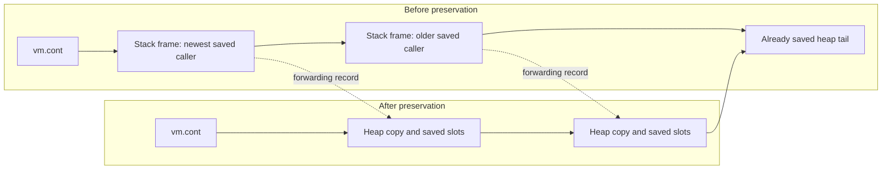
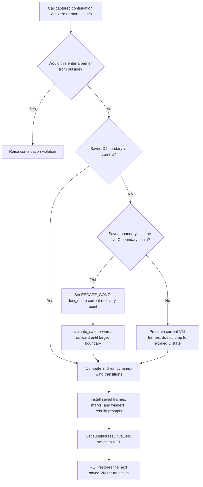

[§1] Continuation capture and invocation
=======================================

[VM architecture](../vm.md) |
[Stack and frames](stack.md) |
[C interaction](c-interface.md) |
[Execution](execution.md) |
[Instructions](instructions.md)

[§2] What is captured
----------------------

A continuation procedure is a C-backed procedure created by
[`make_cont_subr`](../../../src/vm.c#L2431). Its private data contains an
`SgContinuation *` and, for prompt-delimited operations, a capture-time
`SgPrompt *`. Calling it enters `throw_continuation` through ordinary
procedure dispatch.

For a full capture,
[`Sg_VMCallCC`](../../../src/vm.c#L2536) preserves:

| State | Representation |
| ----- | -------------- |
| Pending return actions and saved slots | `cont->cont`, referring to the heap-preserved `SgContFrame` chain. |
| Dynamic-wind context | `cont->winders`. |
| Native boundary identity | `cont->cstack`, referring to the current live C boundary at capture time. |
| Continuation marks | A copy of the mark nodes and key/value entries in `cont->marks`. |
| Continuation kind | `SG_FULL_CONTINUATION`. |

This is not a byte-for-byte snapshot of `SgVM`. In particular, capture does
not save the current `ac` as the eventual result, nor does it copy the
current C activation. The saved frames describe what should happen when
the capture operation returns. Invocation supplies that return's values.

`SgContinuation` also has error-handler/escape-point fields; their use by
[`Sg_VMWithErrorHandler`](../../../src/vm.c#L1511) should not be confused
with the fields initialized by a normal full capture.

[§2] Preserving frames in the heap
----------------------------------

[`save_cont`](../../../src/vm.c#L1580) is shared by continuation capture,
stack spilling, and stack-trace attachment. It preserves the
stack-resident prefix of the current continuation chain; an older heap
tail is already preserved and is shared.

The two passes are:

1. Copy each stack-resident record with
   [`save_a_cont`](../../../src/vm.c#L1543). For a Scheme record, copy
   its `size` preceding slots into its heap `env`. For a C continuation,
   copy its record and trailing opaque payload together. Replace the old
   record's `prev` with a forwarding pointer and set `size = -1`.
2. Follow those forwarding pointers to repair references held by the VM,
   live `SgCStack` records, prompt nodes, continuation marks, active error
   escape points, and floating escape points.

The second pass is essential: a native boundary's `cont`, for example,
must still identify its boundary frame after that frame leaves the stack.
The native boundary itself has not moved into the heap.

Full capture then allocates the continuation object, records the dynamic
state, copies marks using
[`deep_copy_marks`](../../../src/vm.c#L2517), wraps the object as a
procedure, and schedules the receiver with `Sg_VMApply1`.

Copying slots and mark entries is **shallow with respect to Scheme
objects**. Heap object identities, mutable boxes, and mark keys/values are
not recursively cloned. Mark *entries* are copied so replacing an entry
later does not simply overwrite the capture-time entry.

Capture cost includes the newly preserved frames/slots and the copied
marks. It does not include copying an already-heap-resident frame tail or
copying native stack memory.

[§2] Invoking a full continuation
---------------------------------

[`throw_continuation`](../../../src/vm.c#L2379) first checks continuation
barriers, then decides whether a live C boundary must be crossed.

The full-continuation completion in
[`cont_invoke_complete`](../../../src/vm.c#L2004) replaces `vm->cont`,
`vm->marks`, and `vm->dynamicWinders`, then rebuilds prompt bookkeeping from
the installed frame chain.

[`throw_continuation_end`](../../../src/vm.c#L2193) delivers invocation
arguments as the capture's results:

- Zero values: `valuesCount = 0`, `ac = SG_UNDEF`.
- One value: `valuesCount = 1`, value in `ac`.
- More values: first in `ac`, the rest in the VM values buffers.

It sets `pc` to the small `return_code` sequence containing `RET`.
Resumption therefore uses the normal frame restoration rules; it is not
a jump directly to a saved `ac`/`pc` register snapshot.

### [§3] Native boundaries are not resurrected

If a full continuation's recorded C boundary is an active ancestor,
`evaluate_safe` unwinds intervening entries with `longjmp` until that
boundary handles the transition. If the boundary is absent, invocation
can install the saved Scheme frames but does **not** jump to the old
`jmp_buf`.

This distinction does not guarantee that returning through an arbitrary
expired boundary will succeed. `run_loop` stops at a boundary record;
`evaluate_safe` then checks its relationship to the current entry.
Unmatched boundaries outside the explicitly handled completion/sentinel
cases raise `"attempt to return from C continuation boundary."`

See [C boundaries and non-local exits](c-interface.md) and
[`evaluate_safe`](../../../src/vm.c#L3890). A saved Scheme continuation
is not a mechanism for restoring the local variables or instruction
position of a C function that has returned.

### [§3] Repeated invocation

Popping a heap Scheme frame copies its saved slots to the working stack;
it does not destructively pop the captured heap chain. A continuation
procedure is not consumed by a call. Repeated invocation can replay the
saved Scheme return actions and any captured C-continuation callbacks.

This does not reverse heap mutation or external effects. It also does
not remove the prompt/barrier and C-boundary checks on each invocation.

[§2] Dynamic state participates in control transfer
---------------------------------------------------

### [§3] Dynamic winders

[`Sg_VMDynamicWind`](../../../src/vm.c#L1412) implements before/body/after
sequencing through C-continuation callbacks. A winder holds its `before`
and `after` procedures and the marks associated with its installation.
The normal body-return path also preserves multiple result values while
the `after` thunk runs.

For a continuation transfer,
[`throw_cont_compute_handlers`](../../../src/vm.c#L2323) compares the
current and target winder contexts. For a full transfer it arranges
leaving thunks from inner to outer and entering thunks from outer to
inner, excluding shared winders.

[`cont_invoke_body` and `cont_invoke_cc`](../../../src/vm.c#L1902)
run those thunks one at a time using `Sg_VMApply0` and a saved C
continuation. They update the active winder chain and relevant marks as
the transition proceeds. The thunks are Scheme calls and may themselves
perform non-local transfers; this is not an indivisible memory restore.

### [§3] Marks, parameters, and handlers

The mark chain associates entries with continuation frames, and can also
contain virtual mark-only records. Mark entries affect observable dynamic
state: the runtime obtains the current parameterization and the current
exception-handler chain through continuation marks.

Consequently, preserving only stack slots is insufficient. Capture copies
mark entries; restoration/splicing selects the corresponding mark context.
The winder machinery normally runs a thunk with its installation-time
marks, with an explicit different policy for composable transfers.

Sources:
[`vm_add_cont_marks`](../../../src/vm.c#L2827),
[`current exception handlers`](../../../src/vm.c#L378),
[`Sg_CurrentParameterization`](../../../src/parameter.c#L67).

[§2] Prompts, composable continuations, and barriers
---------------------------------------------------

A prompt has a tag, handler, C boundary, installation-time winders, and
barrier flag. Its VM frame has `type == PROMPT_FRAME` and stores the
`SgPrompt *` in `pc`. A separate prompt-node chain locates installed
prompts.

[`Sg_VMCallCP`](../../../src/vm.c#L2730) pushes and installs such a frame
before scheduling its body. A prompt frame is not itself a new C entry.

| Capture entry | Saved C boundary | Invocation model |
| ------------- | ---------------- | ---------------- |
| `Sg_VMCallCC` | Current `vm->cstack`. | Replace the current continuation with the full saved chain. |
| `Sg_VMCallComp` | `NULL`. | Copy/splice the captured segment through its capture-time prompt onto the invocation continuation. Do not discard the invocation continuation as a full throw does. |
| `Sg_VMCallDelimitedCC` | `NULL`. | Abort to the currently matching prompt, establish the prompt context, and restore/compose the captured segment according to the prompt-handler path. |

Sources:
[`full and composable capture`](../../../src/vm.c#L2536),
[`delimited capture`](../../../src/vm.c#L2690),
[`operation completion`](../../../src/vm.c#L2004).

Although their *semantic* extent is prompt-delimited, both prompt-based
capture functions currently call `save_cont` for the whole stack-resident
frame prefix, not just the delimited segment. The composable-capture
implementation explains why partially preserving that prefix would
violate its current representation invariant.

[`splice_cont`](../../../src/vm.c#L1778) copies saved records through the
capture-time prompt and links the resulting segment to the invocation
chain. Mark splicing and winder merging are separate operations.

[`Sg_VMAbortCC`](../../../src/vm.c#L3689) discards work up to an installed
prompt and invokes its handler after the winder transition. Crossing a C
entry uses `SG_VM_ESCAPE_ABORT`, not a copy of the native stack.

Barriers are specially flagged prompt records. The VM rejects composable
capture past a barrier and rejects invocation that would enter a captured
barrier no longer present in the current context. Missing/stale prompts
raise continuation violations, rather than being treated as ordinary
return addresses.

Sources:
[`barrier checks`](../../../src/vm.c#L1720),
[`barrier installation`](../../../src/vm.c#L2807).

Behavioural examples already live in the
[`continuation tests`](../../../test/tests/sagittarius/continuations.scm)
and [`partial-continuation tests`](../../../test/includes/partcont.scm).
