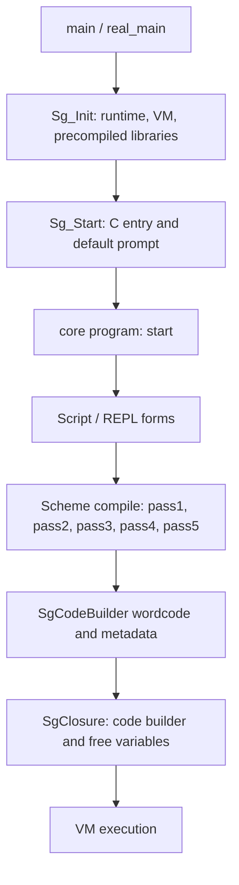

[§1] Execution and runtime state
================================

[VM architecture](../vm.md) |
[Stack and frames](stack.md) |
[Continuations](continuations.md) |
[C interaction](c-interface.md) |
[Instructions](instructions.md)

[§2] From the executable to Scheme
----------------------------------

The platform entry points in [`main.c`](../../../src/main.c#L391) converge
on [`real_main`](../../../src/main.c#L536). It calls `Sg_Init`, obtains
the current VM, processes options, and calls `Sg_Start`.

[`Sg_Init`](../../../src/core.c#L155) initializes the collector, runtime
objects, libraries, root VM, primitive bindings, and precompiled Scheme
libraries in dependency order. The compiler and program-startup libraries
are among those precompiled libraries; their Scheme sources are under
[`boot/`](../../../boot/).

[`Sg_Start`](../../../src/core.c#L730) looks up `(core program)`'s `start`,
enters through `Sg_Apply0`, obtains the default continuation prompt tag,
and schedules `start` under that prompt. The default prompt is installed
by this startup protocol, **not by every call to `evaluate_safe`**.

[`boot/lib/program.scm`](../../../boot/lib/program.scm#L42) selects
standard-mode script loading or the REPL, processes preimports and
expressions, and optionally evaluates a script's `main`.

For evaluation,
[`Sg_Eval`](../../../src/vm.c#L1001) calls the compiler, makes a closure,
and enters `evaluate_safe`. `Sg_VMEval` instead schedules compilation and
uses `next_eval_cc` to arrange execution in the current driver, with
dynamic-wind callbacks managing library context.

The compiler's actual pipeline is in
[`compile-entry`](../../../boot/compiler.scm#L41): `pass0` is currently
an identity operation, `pass1` produces the intermediate form, passes
2 through 4 transform it, and `pass5` emits wordcode ending in `RET`.
[`pass5`](../../../boot/lib/pass5.scm#L530) also establishes per-closure
argument/free-variable metadata and stack-space requirements.

[§2] Wordcode and procedure dispatch
-------------------------------------

[`run_loop`](../../../src/vm.c#L4599) uses computed-goto dispatch under
`__GNUC__`, and a switch/goto-dispatch path otherwise. Instruction bodies
are generated from
[`instructions.scm`](../../../src/instructions.scm) and included in that
loop. [`dist.sh`'s instruction generator](../../../dist.sh#L6) produces
the generated files.

The code stream is an array of machine-sized `SgWord`, not a packed byte
stream. The low eight bits identify the instruction; embedded integer
fields start at bits 8 and 20. Some instructions have additional words
for objects, code builders, or relative branch/frame offsets. Instruction
metadata describes these operand counts and source-information flags.

The [instruction reference](instructions.md) catalogues every active opcode
and its operand, stack, accumulator, and control-flow behaviour, including
the differences between fused instructions and their expanded sequences.

Sources:
[`instruction representation`](../../../src/sagittarius/private/instruction.h#L8),
[`SgCodeBuilder`](../../../src/sagittarius/private/code.h#L56),
[`fetch/dispatch macros`](../../../src/vm.c#L4560).

`pc` advances when an instruction or operand is fetched. A bytecode return
location is therefore a wordcode position, not a native return address.
Instruction fusion, such as global-reference/call combinations, does not
change the underlying call-frame contract.

### [§3] Calling convention

At general call dispatch the procedure is in `ac`; the outgoing arguments
are in the top stack slots. [`vmcall.c`](../../../src/vmcall.c#L145):

| Procedure kind | Dispatch action |
| -------------- | --------------- |
| Scheme closure | Check stack headroom, normalize arguments, select its code and closure, and continue dispatch without a recursive C interpreter call. |
| C primitive (`SgSubr`) | Set `cl` and a default return `pc`, normalize arguments, then call `func(fp, argc, data)` natively. Honour a changed `pc` if the primitive scheduled further VM work. |
| Generic / next method | Select methods or fallback, repackage arguments when required, and dispatch the selected C or Scheme implementation. Scheme method entry also supplies next-method state. |
| Non-procedure object | Route through the generic object-apply machinery. |

Argument adjustment checks required arity and folds or unfolds rest
arguments as appropriate. The `APPLY_CALL` variant handles a trailing list
without always expanding it up front.

`LOCAL_CALL` is a separate compiler-known-closure path and does not repeat
general argument checking. Tail calls reuse the existing continuation;
see [stack and frames](stack.md).

### [§3] Closures, boxes, and global bindings

[`SgClosure`](../../../src/sagittarius/private/closure.h#L36) contains a
code-builder reference and captured free-variable slots. `LREF` addresses
`fp[n]`; `FREF` addresses `cl->frees[n]`. Mutable captured/local bindings
use heap boxes, accessed by assignment and unboxing instructions.

Global access is not necessarily a constant object load.
[`REFER-GLOBAL`](../../../src/instructions.scm#L130) can resolve an
identifier and replace that operand in the wordcode with a global-location
reference. It then reads the binding's current value. Sandbox handling
alters that lookup/caching path. Code storage is therefore not universally
immutable, and caching a global-location identity is not the same as
assuming its value is constant.

[§2] Results are more than the accumulator
------------------------------------------

For a result containing `n` values:

| State | Meaning |
| ----- | ------- |
| `valuesCount` | `n`, including zero. |
| `ac` | First value, when one exists. |
| `values[0]` ... | Values after the first, up to `DEFAULT_VALUES_SIZE` entries. |
| `extra_values` | Additional entries beyond the fixed buffer. |

The fixed buffer currently has 32 entries, allowing the first result plus
32 additional results without an extra buffer. `SG_VALUES_REF` and
`SG_VALUES_SET` abstract the split.

[`VALUES`](../../../src/instructions.scm#L609) assembles this state;
[`RECEIVE`](../../../src/instructions.scm#L392) checks the expected count
and puts bindings/rest values onto the stack. A plain `SgObject` C return
does not encode the number of results.

The same fixed `values` array is temporarily used for **input arguments**
by `Sg_Apply*`. That staging use is distinct from the output convention.
Callbacks invoking other Scheme procedures must preserve all result state
they need afterwards; the
[`dynamic-wind body/after callbacks`](../../../src/vm.c#L1438) illustrate
this explicitly.

Sources:
[`values fields and access macros`](../../../src/sagittarius/private/vm.h#L186),
[`Sg_VMValues`](../../../src/vm.c#L435).

[§2] Allocation, roots, and deferred work
----------------------------------------

VM slots contain `SgObject` representations: heap references or tagged
immediate values, not uniformly unboxed machine numbers. For example,
fixnums have low tag bits `01`; false, true, the empty list, and unspecified
values are distinct tagged constants, not C `NULL`.

Sources:
[`allocation and word definitions`](../../../src/sagittarius/private/sagittariusdefs.h#L167),
[`object tags`](../../../src/sagittarius/private/sagittariusdefs.h#L292).

The normal allocator uses Boehm GC through
[`Sg_malloc` / `GC_MALLOC`](../../../src/core.c#L304). VM arrays, saved
frames, closures, and continuation metadata are allocated in traced
memory. They carry both Scheme references and implementation pointers.
Clearing unused VM stack slots prevents obsolete references from retaining
objects; it is not how native C activations are captured.

Frame addresses are observable internally: C boundaries, marks, prompts,
and escape points hold them. Moving saved records requires the reference
repair in [continuation preservation](continuations.md), even though the
ordinary object allocator itself is not a VM-frame relocation mechanism.

### [§3] Attention checks

[`CHECK_ATTENTION`](../../../src/vm.c#L4591) runs at selected instruction
boundaries, not on every dispatch. Calls, returns, branches, and certain
allocation-related instructions contain checks; simple local references,
for example, do not.

When attention is requested, the interpreter saves a continuation and
calls [`process_queued_requests`](../../../src/vm.c#L4098). A C
continuation preserves the accumulator and multiple results while the
runtime processes pending finalizers and thread suspension/termination.

These checks are a deferred-work protocol. They should not be read as a
claim that GC allocation can occur only at those instruction boundaries.

### [§3] Stack traces also preserve control state

[`Sg_VMAttachStackTrace`](../../../src/vm.c#L3380) calls `save_cont` when
attaching a trace to a compound condition. Frame spilling is therefore
observable during error handling, not just explicit continuation capture
or stack exhaustion. Trace construction relates closure/code metadata,
saved `pc`, and arguments; it is not merely a native stack backtrace.

[§2] Optional native-execution hooks
-------------------------------------

The source also contains VM-facing native-code paths guarded by
`HAVE_JIT`. The following describes their integration points, not a
backend-independent native ABI.

- [`SgCodeBuilder`](../../../src/sagittarius/private/code.h#L72) has
  native-code, call-count, and compilation-state fields.
- The general closure path in
  [`vmcall.c`](../../../src/vmcall.c#L187) can invoke a compiled function
  with the current VM and closure. The declared
  [`SgJitCompiledCode`](../../../src/jit/jit.h#L65) interface continues to
  use `vm->fp`/`vm->sp` for Scheme slots, separately from native stack
  storage.
- A normal native result follows `RET_INSN`. A
  [`yield marker`](../../../src/jit/jit.h#L250) instead returns control to
  interpreter dispatch with VM state already arranged. The
  preserve-accumulator yield variant keeps a helper's prepared `ac`.
- [`native return marks`](../../../src/vm.c#L3051) associate a native
  re-entry address with a particular VM continuation frame. A raw wordcode
  return `pc` and this native address are different pieces of state.
- [`CHECK_JIT_REENTRY_BEFORE_POP`](../../../src/vm.c#L4183) checks the
  specific returning frame before its marks are removed, restores its
  stack/closure state, and invokes the re-entry trampoline. A heap frame
  still requires copying its saved slots back to the VM stack.
- Continuation-splicing completion paths explicitly
  [`clear native return marks and returnAddr`](../../../src/vm.c#L2022)
  when the continuation topology changes.
- [`jitContext`](../../../src/sagittarius/private/vm.h#L316) holds
  backend bookkeeping, including saved VM pointers and a re-entry address.
  The recovery boundary in `evaluate_safe` remains a live C `setjmp`
  scope; the presence of these fields does not capture or recreate native
  activations.

These paths share the VM's frame, dynamic-state, result, and non-local-exit
contracts. Native code availability does not change what the continuation
capture routine actually preserves.
