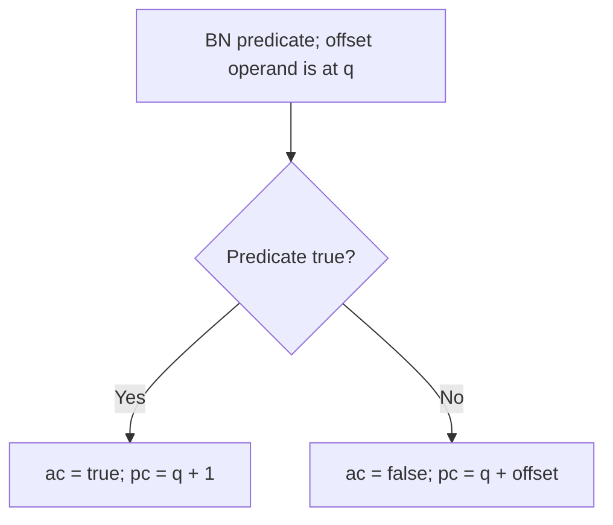

[§1] VM instruction reference
=============================

[VM architecture](../vm.md) |
[Stack and frames](stack.md) |
[Continuations](continuations.md) |
[C interaction](c-interface.md) |
[Execution](execution.md)

This reference covers all **100 active instructions**, including fused
instructions, defined in
[`src/instructions.scm`](../../../src/instructions.scm). The generated
[`src/vminsn.c`](../../../src/vminsn.c) contains their metadata, fusion
table, and interpreter bodies. It is a generated build product, available
after code generation, not a separately maintained implementation.

[`geninsn`](../../../src/geninsn#L264) assigns opcode numbers in definition
order. The numbers below describe this source tree, not a stable external
bytecode ABI. The definitions inside the final block comment, such as
`ADDI_PUSH`, are not active instructions.

[§2] Encoding and notation
--------------------------

An instruction occupies one `SgWord`, optionally followed by operand words.
The source declaration has the form `define-inst NAME (values operands src?)`:

- `values` counts integers embedded in the instruction word: zero, one,
  or two. It is unrelated to Scheme multiple result values.
- `operands` counts additional words in the code stream.
- `src?` marks instructions that can carry source information in code
  metadata; it does not add a source-location operand to the instruction.
- `:label` marks a trailing relative-label operand.

The generated
[`encoding macros`](../../../src/sagittarius/private/instruction.h#L8)
use the low eight bits for the opcode. With one embedded integer,
`INSN_VALUE1` extracts the signed payload above bit 7. With two,
`INSN_VAL2` masks the first to 12 bits and extracts the second above bit
19. Extraction casts the word to `int` before shifting: these are not
arbitrary pointer-width integer payloads.

```text
Common 32-bit instruction encoding within an SgWord:

one integer:   [ signed value: bits 31..8       ][ opcode: 7..0 ]
two integers:  [ value2: 31..20 ][ value1: 19..8 ][ opcode: 7..0 ]

Following operand words retain the full SgWord width.
```

In the tables:

- `OP(i,j) operand` means two embedded integers and one following word.
  `OP operand` has no embedded integer and one following word.
- `a` is the incoming `ac`; `s` is an item popped from the top of the VM
  stack. A stack listing runs from older/lower to newer/higher slots.
- `result(v)` means `ac = v` and `valuesCount = 1`. It is descriptive
  notation, not a VM instruction or a C helper.
- A plain assignment to `ac` does not imply a `valuesCount` change.
  Effects not mentioned are preserved by the direct instruction body.
- Stack changes describe valid execution without frame spilling.
  [`CHECK_STACK`](../../../src/vm.c#L1137) can compact the working stack,
  and call/return operations have their own frame effects.

The VM assumes compiler-produced wordcode. Slot indices, frame capacity,
box contents, and compiler-known closure calls are not universally
validated. Scheme-level type/arity checks do not make this an untrusted
bytecode verifier. Helper calls can allocate, call Scheme, or exit
non-locally; the tables describe successful completion.

[§2] Constants, bindings, and closures
--------------------------------------

Sources:
[`constants and variable access`](../../../src/instructions.scm#L76),
[`closure creation`](../../../src/instructions.scm#L428),
[`binding/library instructions`](../../../src/instructions.scm#L550).

| Opcode | Instruction | Stack change | Effect |
| ------ | ----------- | ------------ | ------ |
| 0x02 | `UNDEF` | 0 | `result(SG_UNDEF)`. |
| 0x03 | `CONST object` | 0 | `result(object)`; consume one operand word. |
| 0x04 | `CONSTI(i)` | 0 | `result(fixnum(i))`; no object operand word. |
| 0x05 | `LREF(i)` | 0 | `result(fp[i])`. |
| 0x06 | `LSET(i)` | 0 | Write `a` into the box in `fp[i]`; `result(SG_UNDEF)`. |
| 0x07 | `FREF(i)` | 0 | `result(cl->frees[i])`. |
| 0x08 | `FSET(i)` | 0 | Write `a` into the box in `cl->frees[i]`; `result(SG_UNDEF)`. |
| 0x09 | `GREF binding` | 0 | Resolve/read an identifier or global location; `result(binding value)`. |
| 0x0a | `GSET binding` | 0 | Store `a` through a global location, or resolve/create the identifier's binding and cache its location; `result(SG_UNDEF)`. |
| 0x0b | `PUSH` | +1 | Push `a`; keep `ac` and `valuesCount`. |
| 0x0c | `BOX(i)` | 0 | Replace slot `sp[-i-1]` with a box containing its previous value. Keep `ac` and result count. |
| 0x0d | `UNBOX` | 0 | Set `ac` to the value in box `a`; keep result count. |
| 0x29 | `CLOSURE(self) code` | `-code->freec` | Copy captured stack values into a new closure; `result(closure)`. Nonzero `self` installs the closure at free-variable index `self-1`. |
| 0x33 | `DEFINE(flags) identifier` | 0 | Define the identifier's binding as `a`, passing `flags` to `Sg_MakeBinding`; set `ac = SG_UNDEF`, without resetting result count. |
| 0x34 | `LIBRARY name` | 0 | Select the named current library. Used as a compiled-library/cache marker; keep accumulator and result count. |

`GREF` can replace an identifier operand with a global-location reference.
Sandbox lookup and unbound-variable handling can take different paths;
see [global binding behaviour](execution.md). `BOX` is indexed from `sp`,
whereas local references and `INST_STACK` are indexed from `fp`.

The `CLOSURE` embedded value is a self-reference position, **not** the
number of free variables. That count comes from the code-builder operand;
[`Sg_VMMakeClosure`](../../../src/closure.c#L46) establishes the final
free-variable order.

[§2] Stack management and basic control
---------------------------------------

Sources:
[`NOP` and `HALT`](../../../src/instructions.scm#L71),
[`FRAME`, `INST_STACK`, and `LEAVE`](../../../src/instructions.scm#L532),
[`RESV_STACK`](../../../src/instructions.scm#L812).

| Opcode | Instruction | Stack change | Effect |
| ------ | ----------- | ------------ | ------ |
| 0x00 | `NOP` | 0 | Continue dispatch. |
| 0x01 | `HALT` | 0 | Return `ac` directly from `run_loop`; do not pop VM frames or run winders. |
| 0x30 | `FRAME offset` | `+CONT_FRAME_SIZE` | Save the caller's live slots/register state in a continuation record whose return location is the relative target. |
| 0x31 | `INST_STACK(i)` | 0 | Store `a` directly in `fp[i]`; this is not a boxed-variable assignment. |
| 0x32 | `LEAVE(n)` | `-n` | Remove the top `n` slots without restoring a continuation frame. |
| 0x63 | `RESV_STACK(n)` | `+n` | Reserve slots by advancing `sp`; do not initialize them or change `ac`. |

`FRAME` leaves `fp` unchanged while outgoing arguments are prepared.
`CALL`, not `FRAME`, establishes the callee's argument-frame base.
`LEAVE` is for slot removal, not procedure return. `RESV_STACK` relies on
compiler-established capacity and initialization before reads; its source
comment's comparison to repeated `UNDEF`/`PUSH` is not a promise that it
actually writes unspecified objects.

`HALT` is not a substitute for `RET`: the surrounding
[`evaluate_safe`](../../../src/vm.c#L3917) still checks boundary
completion after `run_loop` returns.

[§2] Arithmetic
----------------

Source: [`numeric instructions`](../../../src/instructions.scm#L191).
Binary forms consume the left operand from the stack; `a` is the right
operand. Immediate forms instead use the embedded integer as the **left**
operand. This is especially important for subtraction and division.

| Opcode | Instruction | Stack change | Effect |
| ------ | ----------- | ------------ | ------ |
| 0x0e | `ADD` | -1 | `result(s + a)`. |
| 0x0f | `ADDI(i)` | 0 | `result(i + a)`. |
| 0x10 | `SUB` | -1 | `result(s - a)`. |
| 0x11 | `SUBI(i)` | 0 | `result(i - a)`, not `a - i`. |
| 0x12 | `MUL` | -1 | `result(s * a)`. |
| 0x13 | `MULI(i)` | 0 | `result(i * a)`. |
| 0x14 | `DIV` | -1 | `result(s / a)`. |
| 0x15 | `DIVI(i)` | 0 | `result(i / a)`, not `a / i`. |
| 0x16 | `NEG` | 0 | `result(-a)`. |

The bodies mix immediate/floating-point fast paths and general numeric
helpers; these descriptions are Scheme numeric operations, not a claim
that all operands or results are machine integers. Type errors and
undefined exact division can raise conditions.

[§2] Branches, comparisons, and argument shifting
------------------------------------------------

Sources:
[`TEST`, `JUMP`, and branch helpers](../../../src/instructions.scm#L272),
[`comparison results`](../../../src/instructions.scm#L367).

| Opcode | Instruction | Stack change | Effect |
| ------ | ----------- | ------------ | ------ |
| 0x17 | `TEST offset` | 0 | Jump if `a` is `#f`; otherwise skip the operand. Keep `ac` and result count. |
| 0x18 | `JUMP offset` | 0 | Unconditionally jump to the relative target. |
| 0x19 | `SHIFTJ(n,base)` | Set `sp = fp + base + n` | Move the top `n` arguments to `fp + base`; keep `fp` and `cont`. Does not itself branch. |
| 0x1a | `BNNUME offset` | -1 | Test numeric `s = a`; jump if false. |
| 0x1b | `BNLT offset` | -1 | Test numeric `s < a`; jump if false. |
| 0x1c | `BNLE offset` | -1 | Test numeric `s <= a`; jump if false. |
| 0x1d | `BNGT offset` | -1 | Test numeric `s > a`; jump if false. |
| 0x1e | `BNGE offset` | -1 | Test numeric `s >= a`; jump if false. |
| 0x1f | `BNEQ offset` | -1 | Test `eq?(s, a)`; jump if false. |
| 0x20 | `BNEQV offset` | -1 | Test `eqv?(s, a)`; jump if false. |
| 0x21 | `BNNULL offset` | 0 | Test whether `a` is the empty list; jump if false. |
| 0x22 | `NOT` | 0 | `result(a == #f)`. |
| 0x23 | `NUM_EQ` | -1 | `result(s = a)` numerically. |
| 0x24 | `NUM_LT` | -1 | `result(s < a)` numerically. |
| 0x25 | `NUM_LE` | -1 | `result(s <= a)` numerically. |
| 0x26 | `NUM_GT` | -1 | `result(s > a)` numerically. |
| 0x27 | `NUM_GE` | -1 | `result(s >= a)` numerically. |

All `BN*` instructions put the tested boolean in `ac` but do **not** reset
`valuesCount`. A successful predicate falls through; a failed predicate
takes the offset. `TEST` differs by preserving its original accumulator
value, which need not be a boolean.

If the opcode is at word `p`, its offset operand is at `q = p + 1`.
For `TEST`, `JUMP`, the `BN*` instructions, and `FRAME`, the target is
**`q + offset`**, not `p + offset` or the end of the instruction plus the
offset. The fall-through position is `q + 1`.



`SHIFTJ` supports compiler-transformed local jumps: it keeps selected
lower slots while replacing the argument suffix. The compiler emits the
actual `JUMP` separately in
[`pass5/jump-call`](../../../boot/lib/pass5.scm#L894).

[§2] Procedure calls and returns
--------------------------------

Sources:
[`call instructions`](../../../src/instructions.scm#L482),
[`general call dispatch`](../../../src/vmcall.c#L145),
[`RET_INSN`](../../../src/vm.c#L4160).

| Opcode | Instruction | Stack change | Effect |
| ------ | ----------- | ------------ | ------ |
| 0x2b | `CALL(n)` | Call-dependent | Dispatch procedure `a` with `n` stack arguments; normalize arity/rest arguments and establish `fp`. Does not push a caller continuation. |
| 0x2c | `LOCAL_CALL(n)` | No argument adjustment | Enter compiler-known closure `a` directly with `fp = sp - n`, selecting its `cl` and `pc`. |
| 0x2d | `TAIL_CALL(n)` | Replace current argument frame | Move top `n` arguments to current `fp`, then perform general `CALL` with the existing continuation. |
| 0x2e | `LOCAL_TAIL_CALL(n)` | Replace current argument frame | Shift arguments and directly enter a compiler-known closure. |
| 0x2f | `RET` | Restore/unlink return state | Skip prompt records; restore a Scheme frame, invoke a saved C callback, re-enter native code when applicable, or return to the C boundary. |

For a non-tail call, the compiler supplies a preceding `FRAME`.
General `CALL` resets `valuesCount` to one on entry; the callee determines
the eventual result state. Local calls omit general procedure/arity
checking and that general-dispatch reset. They require the compiler's
known-closure/argument assumptions.

A C primitive may change `pc` to schedule work instead of returning a final
Scheme value. Consequently, a call instruction is not simply a native
function call followed by one fixed stack adjustment. See
[C interaction](c-interface.md) for the handoff contract and
[stack and frames](stack.md) for return restoration.

### [§3] Apply adapters

| Opcode | Instruction | Stack change | Effect |
| ------ | ----------- | ------------ | ------ |
| 0x2a | `APPLY(n,tail)` | Call-dependent | Take a procedure and fixed arguments from the stack, the final argument list from `a`, and dispatch their combined application. |
| 0x62 | `APPLY_VALUES(n) rest` | Stage arguments, then tail-call | Take procedure `a`, stage up to 32 arguments from `vm->values`, append the operand list's remaining arguments, then enter `TAIL_CALL(n)`. |

For `APPLY`, `n` counts the procedure, fixed arguments, and final list:
there are `n - 2` fixed arguments. Its incoming stack is
`[..., procedure, fixed0, ..., fixedK]`, with the list in `ac`. An improper
final list is rejected.

`tail == 1` shifts the assembled arguments to the current frame; otherwise
the compiler's ordinary caller frame remains. A nonempty trailing list
can enter the `APPLY_CALL` variant of general dispatch, which folds or
unfolds it according to the callee's argument convention instead of always
expanding it in advance.

`APPLY_VALUES` is the internal adapter used by
[`Sg_Apply*`](../../../src/vm.c#L1240). Its `n` is the complete argument
count, including arguments supplied in `rest`; the fixed-array and list
contents must agree with that count. Its name does not mean that it reads
the ordinary first-result-plus-extra-results protocol.

[§2] Multiple values
--------------------

Sources:
[`RECEIVE`](../../../src/instructions.scm#L392),
[`VALUES`](../../../src/instructions.scm#L609).

| Opcode | Instruction | Stack change | Effect |
| ------ | ----------- | ------------ | ------ |
| 0x28 | `RECEIVE(required,rest)` | `+required`, plus one if `rest` | Check `valuesCount`; push required bindings and, when requested, a list of the remaining values. Set `valuesCount = 1`. |
| 0x3a | `VALUES(n)` | `-max(n-1,0)` | Arrange `n` results: the last input is `a`, earlier inputs are stack values. Put the first result in `ac`, the rest in values buffers; set `valuesCount = n`. |

With `rest == 0`, `RECEIVE` requires exactly `required` values. With a rest
binding it requires at least that many. `RECEIVE(0,1)` pushes one list of
all values. It places bindings on the stack rather than computing a new
accumulator result.

For `VALUES(0)`, the accumulator does not denote a result even though its
old contents remain. Extra results use the fixed array and optional
overflow buffer described under [execution state](execution.md).

[§2] Pairs and lists
--------------------

Sources:
[`pair/list operations`](../../../src/instructions.scm#L571),
[`mutation and nested access`](../../../src/instructions.scm#L715).

| Opcode | Instruction | Stack change | Effect |
| ------ | ----------- | ------------ | ------ |
| 0x35 | `CAR` | 0 | Require pair `a`; `result(car(a))`. |
| 0x36 | `CDR` | 0 | Require pair `a`; `result(cdr(a))`. |
| 0x37 | `CONS` | -1 | `result(cons(s, a))`. |
| 0x38 | `LIST(n)` | `-max(n-1,0)` | Make a list from earlier stack arguments followed by `a`; `result(list)`. For zero arguments, return the empty list. |
| 0x39 | `APPEND(n)` | `-max(n-1,0)` | Append earlier proper-list stack arguments onto final argument `a`; `result(appended value)`. For zero arguments, return the empty list. |
| 0x4c | `SET_CAR` | -1 | Set the popped pair's car to `a`; `result(SG_UNDEF)`. |
| 0x4d | `SET_CDR` | -1 | Set the popped pair's cdr to `a`; `result(SG_UNDEF)`. |
| 0x4e | `CAAR` | 0 | `result(car(car(a)))`, checking both pair accesses. |
| 0x4f | `CADR` | 0 | `result(car(cdr(a)))`, checking both pair accesses. |
| 0x50 | `CDAR` | 0 | `result(cdr(car(a)))`, checking both pair accesses. |
| 0x51 | `CDDR` | 0 | `result(cdr(cdr(a)))`, checking both pair accesses. |

Pair mutation rejects constant literals. `APPEND` permits a non-list final
argument; only the preceding arguments must be proper lists. The count
operands are argument counts, not counts of stack values alone.

[§2] Predicates and vectors
---------------------------

Source: [`predicates and vectors`](../../../src/instructions.scm#L626).

| Opcode | Instruction | Stack change | Effect |
| ------ | ----------- | ------------ | ------ |
| 0x3b | `EQ` | -1 | `result(eq?(s, a))`. |
| 0x3c | `EQV` | -1 | `result(eqv?(s, a))`. |
| 0x3d | `NULLP` | 0 | `result(null?(a))`. |
| 0x3e | `PAIRP` | 0 | `result(pair?(a))`. |
| 0x3f | `SYMBOLP` | 0 | `result(symbol?(a))`. |
| 0x40 | `VECTOR(n)` | `-max(n-1,0)` | Construct a vector from earlier stack arguments followed by `a`; `result(vector)`. Zero arguments produce an empty vector. |
| 0x41 | `VECTORP` | 0 | `result(vector?(a))`. |
| 0x42 | `VEC_LEN` | 0 | Require a vector; `result(vector length)` as a fixnum. |
| 0x43 | `VEC_REF` | -1 | Pop a vector, use fixnum index `a`, and bounds-check; `result(element)`. |
| 0x44 | `VEC_SET` | -2 | Pop index then vector, store `a`, and `result(SG_UNDEF)`. |

`VEC_SET` expects `[..., vector, index]` on the stack, not the reverse.
It rejects immutable literal vectors as well as invalid types or indices.

[§2] Fused instructions
-----------------------

Sources:
[`fusion definitions`](../../../src/instructions.scm#L693),
[`generator result modes`](../../../src/geninsn#L133),
[`generated push/call variants`](../../../src/vminsn.c#L963).

Fusion is not necessarily a register-for-register execution of the
spelled-out instruction sequence:

- Simple `*_PUSH` variants write the produced value directly to the stack
  and set `valuesCount = 1`, without a final write of that value to `ac`.
  This includes `CAR_PUSH`, `CDR_PUSH`, and `CONS_PUSH`.
- A reference followed by `CAR_PUSH`/`CDR_PUSH` first loads the referenced
  pair into `ac`, then pushes the selected component. Its `ac` is not the
  pushed component.
- `CONST_RET` sets `ac` and immediately returns, but unlike `CONST` does
  **not** reset `valuesCount`.

These are direct-body effects; global lookup can itself call Scheme on a
slow path. Do not rely on an unused accumulator being preserved by
arbitrary helper calls.

| Opcode | Instruction | Stack change | Effect |
| ------ | ----------- | ------------ | ------ |
| 0x45 | `LREF_PUSH(i)` | +1 | Push `fp[i]` directly. |
| 0x46 | `FREF_PUSH(i)` | +1 | Push `cl->frees[i]` directly. |
| 0x47 | `GREF_PUSH binding` | +1 | Push the resolved global value directly. |
| 0x48 | `CONST_PUSH object` | +1 | Consume the operand word and push its object directly. |
| 0x49 | `CONSTI_PUSH(i)` | +1 | Push `fixnum(i)` directly. |
| 0x4a | `GREF_CALL(n) binding` | Call-dependent | Load the global procedure into `ac`, then enter `CALL(n)`. |
| 0x4b | `GREF_TAIL_CALL(n) binding` | Tail-call-dependent | Load the global procedure, then enter `TAIL_CALL(n)`. |
| 0x52 | `CAR_PUSH` | +1 | Require pair `a`; push `car(a)` directly. |
| 0x53 | `CDR_PUSH` | +1 | Require pair `a`; push `cdr(a)` directly. |
| 0x54 | `CONS_PUSH` | 0 | Pop `s`, then push `cons(s, a)` directly. |
| 0x55 | `LREF_CAR(i)` | 0 | Load local pair; `result(car(pair))`. |
| 0x56 | `LREF_CDR(i)` | 0 | Load local pair; `result(cdr(pair))`. |
| 0x57 | `FREF_CAR(i)` | 0 | Load free-variable pair; `result(car(pair))`. |
| 0x58 | `FREF_CDR(i)` | 0 | Load free-variable pair; `result(cdr(pair))`. |
| 0x59 | `GREF_CAR binding` | 0 | Load global pair; `result(car(pair))`. |
| 0x5a | `GREF_CDR binding` | 0 | Load global pair; `result(cdr(pair))`. |
| 0x5b | `LREF_CAR_PUSH(i)` | +1 | Load local pair into `ac`, then push its car. |
| 0x5c | `LREF_CDR_PUSH(i)` | +1 | Load local pair into `ac`, then push its cdr. |
| 0x5d | `FREF_CAR_PUSH(i)` | +1 | Load free-variable pair into `ac`, then push its car. |
| 0x5e | `FREF_CDR_PUSH(i)` | +1 | Load free-variable pair into `ac`, then push its cdr. |
| 0x5f | `GREF_CAR_PUSH binding` | +1 | Load global pair into `ac`, then push its car. |
| 0x60 | `GREF_CDR_PUSH binding` | +1 | Load global pair into `ac`, then push its cdr. |
| 0x61 | `CONST_RET object` | Return-dependent | Load operand into `ac`, preserve result count, then perform `RET_INSN`. |

Fused accessors retain their base operation's type checks; fused calls
retain the general call protocol. Attention polling is determined by the
generated bodies and the operations they enter, not simply by the number
of names combined in an opcode.
