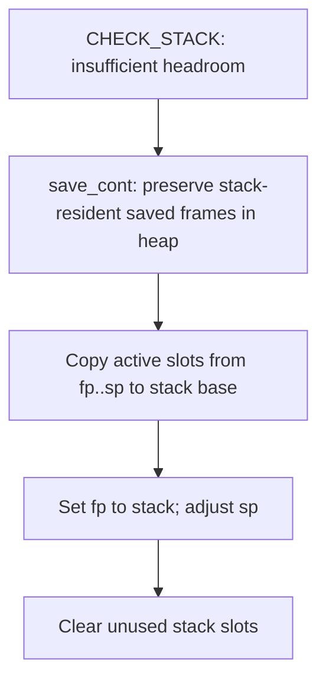

[§1] VM stack and frames
========================

[VM architecture](../vm.md) |
[Continuations](continuations.md) |
[C interaction](c-interface.md) |
[Execution](execution.md) |
[Instructions](instructions.md)

[§2] Registers and storage
--------------------------

The register set lives in
[`SgVM`](../../../src/sagittarius/private/vm.h#L261); the interpreter's
[`PC`, `AC`, `CL`, `FP`, `SP`, and `CONT` macros](../../../src/vm.c#L412)
access those fields directly.

| Register | Interpretation |
| -------- | -------------- |
| `pc` | Wordcode instruction/operand pointer. Fetch advances it. |
| `ac` | Accumulator, procedure being dispatched, or first result value. |
| `cl` | Current procedure; for Scheme code, the closure holding free variables and code. |
| `fp` | Base of the active argument/local frame. |
| `sp` | Next unused VM stack slot. Pushing stores then increments it. |
| `cont` | Next saved return action, which can reside in the stack or heap. |

`[fp, sp)` contains arguments, local bindings, and temporary evaluation
values. Locals are indexed upwards from `fp`; `INDEX(sp, 0)` addresses the
last occupied slot. Multiple results also use VM fields outside this stack,
as described under [execution state](execution.md).

[`Sg_NewVM`](../../../src/vm.c#L304) allocates
`SG_VM_STACK_SIZE` slots, currently 10,000. The normal
[`thread_entry`](../../../ext/threads/threads.c#L77) path also uses a
heap-allocated array; its alternative `alloca` path is disabled. Neither
path makes Scheme arguments native C call arguments.

[§2] An ordinary non-tail call
------------------------------

The compiler emits `FRAME` before preparing a non-tail call. At that
moment, the VM stores a continuation record at the old `sp`, remembering
the caller's live slot count and return state. It then pushes outgoing
arguments above that record. `CALL` normalizes arguments and sets the
callee's `fp`.

The procedure itself is in `ac`, not an extra argument slot:

```text
Higher addresses

sp ------------> next unused slot
                 callee temporaries / local bindings, if any
                 callee argument n - 1
                 ...
fp ------------> callee argument 0
                 +--------------------------------------+
                 | continuation record for the caller   |
cont ----------> | prev, size/type, pc, cl, fp, ...      |
                 +--------------------------------------+
                 caller's saved temporaries / locals
                 ...
saved fp ------> caller's first live slot
                 older frames and slots
stack ---------> base of the VM stack

Lower addresses
```

This is the ordinary in-stack case, not a universal adjacency rule.
`cont` may instead refer to a heap frame.

Sources:
[`PUSH_CONT_REC`](../../../src/vm.c#L1198),
[`FRAME`, `CALL`, and local-call instructions](../../../src/instructions.scm#L476),
[`pass5/normal-call`](../../../boot/lib/pass5.scm#L932).

### [§3] Continuation record fields

The actual layout is
[`SgContFrame`](../../../src/sagittarius/private/vm.h#L76):

| Field | Role |
| ----- | ---- |
| `prev` | Older continuation record. |
| `size` | Number of saved live slots for a Scheme frame, or payload slots for a C continuation. `-1` temporarily denotes a forwarded stack record. |
| `type` | Normal, C-entry boundary, or prompt frame. |
| `pc` | Return wordcode pointer, boundary marker, prompt pointer, or C callback pointer, depending on frame kind. |
| `cl` | Procedure to restore. |
| `fp` | Saved in-stack frame base; `NULL` identifies a C continuation. |
| `env[1]` | Start of the saved Scheme slots in the heap representation. |

`CONT_FRAME_SIZE` is `sizeof(SgContFrame) / sizeof(SgObject)`, including the
declared `env[1]` member. Do not infer word offsets from the schematic
diagram: integer packing differs between 32-bit and 64-bit builds.

For an ordinary **stack** frame, the `size` saved slots are immediately
*before* its record. When preserved in the **heap**, they are copied into
the record's `env` area. The saved `fp` pointer is not used to reconstruct
a heap frame.

### [§3] Special records

| Kind | Recognition | Meaning of `pc` |
| ---- | ----------- | --------------- |
| Normal Scheme return | `type == NORMAL_FRAME`, `fp != NULL` | Return location in wordcode. |
| C-entry boundary | `type == BOUNDARY_FRAME` | Address of the boundary marker, not a return instruction. |
| Continuation prompt | `type == PROMPT_FRAME` | `SgPrompt *`, not wordcode. |
| C continuation | `fp == C_CONT_MARK`, where the marker is `NULL` | `SgCContinuationProc *` callback. Its `type` is normal. |

A C continuation's payload starts **after the full fixed record**,
at `(SgObject *)frame + CONT_FRAME_SIZE`. This differs from saved Scheme
slots in `env`.

Sources:
[`vm_new_cont` and frame constructors](../../../src/vm.c#L1144),
[`frame-kind tests and save_a_cont`](../../../src/vm.c#L1533).

[§2] Returning
---------------

[`RET_INSN`](../../../src/vm.c#L4160) first skips prompt records, removing
their prompt/mark bookkeeping. It returns from the interpreter loop if
the next record is a C-entry boundary or there is no record. Otherwise,
[`POP_CONT_DIRECT`](../../../src/vm.c#L3555) handles the return:

| Record location/kind | Restoration |
| -------------------- | ----------- |
| Stack Scheme frame | Restore `pc`, `cl`, `fp`; set `sp = fp + size`; advance `cont` to `prev`. |
| Heap Scheme frame | Set `fp = sp = stack`; copy `size` slots from `env` into the stack; restore `pc` and `cl`; advance `cont`. |
| C continuation, stack or heap | Copy its payload to a temporary C array; unlink the record; restore `cl`; arrange a default `RET`; call `after(ac, data)` and put its return value in `ac`. |

The ordinary pop also removes a mark-chain entry. In native-enabled builds,
a frame-specific native re-entry check occurs before this pop; see
[execution](execution.md).

Heap restoration copies slots back to a working stack; it does not move or
consume the saved heap record. The same saved Scheme return state can
therefore be used again.

Initialization is a special case:
[`Sg_SetVMStack`](../../../src/vm.c#L304) initially points `cont` at the
stack base. Frame walkers must account for the sentinel/cyclic bottom
shapes recognized by
[`bottom_cont_frame_p`](../../../src/vm.c#L1677), rather than assuming
every chain ends at `NULL`.
[`evaluate_safe`](../../../src/vm.c#L3917) also contains a compatibility
case for a two-frame boundary cycle.

[§2] Tail calls and lexical bindings
------------------------------------

For a tail call, the compiler omits `FRAME`. `TAIL_CALL` uses
[`shift_args`](../../../src/vm.c#L4051) to copy the outgoing argument block
from the top of the stack down to the current `fp`. It then enters general
call dispatch with the existing `cont`. The callee returns to the current
procedure's caller.

`LOCAL_CALL` and `LOCAL_TAIL_CALL` enter a compiler-known closure directly,
without the general procedure-kind dispatch and argument normalization.
The local tail-call instruction performs the same argument shift.

Sources:
[`call instructions`](../../../src/instructions.scm#L489),
[`local-call emission`](../../../boot/lib/pass5.scm#L839).

Ordinary lexical bindings need not introduce a continuation record.
For example,
[`pass5/let`](../../../boot/lib/pass5.scm#L733) extends the local-slot
environment and emits `LEAVE` in a non-tail context to remove its slots.
Mutable locals/free variables use boxes; closures copy captured references
into their `frees` array. Consequently, a continuation preserves slot
values, not a historical copy of the mutable objects those slots refer to.

Sources:
[`LREF`, `LSET`, `FREF`, `FSET`, and `BOX`](../../../src/instructions.scm#L87),
[`Sg_VMMakeClosure`](../../../src/closure.c#L46).

[§2] Stack exhaustion is spilling, not buffer growth
---------------------------------------------------

Despite its name, [`expand_stack`](../../../src/vm.c#L1639) does not
allocate a larger stack array:



[`CHECK_STACK`](../../../src/vm.c#L1137) is used at call sites and other
reservation points. General closure calls use the code builder's
`maxStack` metadata; the compiler calculates per-closure requirements in
[`pass5/compile-lambda`](../../../boot/lib/pass5.scm#L530).

Important consequences:

- Non-tail recursion can accumulate heap-saved frames without keeping
  all pending callers in the fixed stack array.
- A raw pointer into the active slot area can become logically stale
  after compaction, even though the array's allocation address is unchanged.
  C code must not retain an argument-slot pointer across an operation that
  can compact the stack and then assume it still denotes the same argument.
- This is not an unlimited-size guarantee for one active frame or one
  contiguous argument block. The check spills once; it is not a general
  grow-and-retry allocator.
- Although `Sg_SetVMStack` accepts a size, the current
  [`IN_STACK_P`](../../../src/vm.c#L425) test uses `SG_VM_STACK_SIZE`.
  The normal allocation and membership convention must remain consistent.
